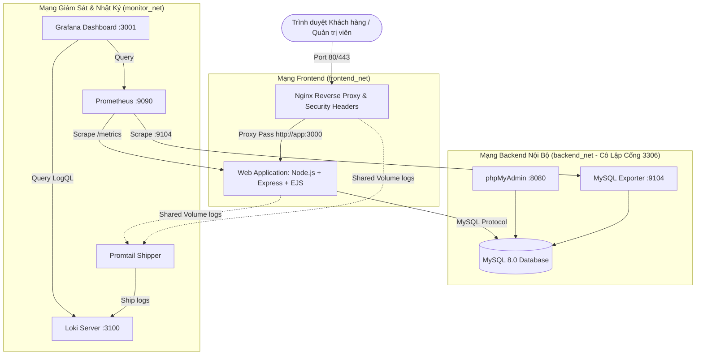

# HỆ THỐNG ĐẶT VÉ XEM PHIM / SỰ KIỆN - ĐỀ TÀI SỐ 11
> **Học phần:** Triển khai và Quản trị Hệ thống Phần mềm  
> **Sinh viên thực hiện:** Nguyễn Duy Trường  
> **Mã sinh viên:** DTC245200120  
> **Lớp:** CNTTK23E  
> **GitHub Repository:** [https://github.com/truong256/cinema-ticket-booking-system.git](https://github.com/truong256/cinema-ticket-booking-system.git)  


---

## 1. GIỚI THIỆU HỆ THỐNG
Hệ thống **Đề 11 – Hệ thống Đặt vé Xem phim / Sự kiện** là một giải pháp trực tuyến toàn diện cho phép khách hàng tra cứu lịch chiếu, lựa chọn ghế ngồi trực quan theo từng loại phòng chiếu (Standard, IMAX, VIP Lounge), tính toán giá vé tự động và thực hiện thanh toán giả lập (VNPAY QR, MoMo, Thẻ ATM nội địa). 

Hệ thống được đóng gói và vận hành hoàn chỉnh trên nền tảng **Docker Compose** với 9 dịch vụ phân tầng bảo mật, tích hợp đầy đủ hệ thống cân bằng tải & Gateway **Nginx Reverse Proxy**, hệ thống giám sát hiệu năng **Prometheus + Grafana**, hệ thống quản lý nhật ký tập trung **Loki + Promtail**, cùng 6 kỹ thuật siết chặt an ninh (**Hardening**).

---

## 2. KIẾN TRÚC TỔNG THỂ & SƠ ĐỒ MẠNG NỘI BỘ



---

## 3. DANH SÁCH 10 DỊCH VỤ DOCKER COMPOSE

| STT | Tên Service | Image Docker | Cổng Host | Vai trò trong hệ thống |
|:---:|---|---|:---:|---|
| 1 | **app** | `Dockerfile (node:20-alpine)` | Nội bộ (3000) | Web App đặt vé, render EJS, xuất Prometheus metrics `/metrics`, chạy user non-root `node` |
| 2 | **mysql** | `mysql:8.0` | **Không map ra host** | Lưu trữ CSDL, Transaction ACID, chống đặt trùng ghế (`uq_showtime_seat`) |
| 3 | **phpmyadmin** | `phpmyadmin/phpmyadmin` | `8080:80` | Quản trị CSDL MySQL trực quan |
| 4 | **nginx** | `nginx:1.25-alpine` | `80:80`, `443:443` | Reverse Proxy, SSL tự ký, kiểm soát Security Headers |
| 5 | **mysql-exporter**| `prom/mysqld-exporter:v0.15.1`| Nội bộ (9104) | Thu thập metrics hiệu năng CSDL MySQL qua file cấu hình `.my.cnf` |
| 6 | **cadvisor** | `gcr.io/cadvisor/cadvisor:v0.49.1` | `8081:8080` | Giám sát tài nguyên CPU, RAM, Network I/O của toàn bộ Containers |
| 7 | **prometheus** | `prom/prometheus:v2.51.0` | `9090:9090` | Thu thập và lưu trữ time-series metrics |
| 8 | **grafana** | `grafana/grafana:10.4.1` | `3001:3000` | Dashboard trực quan hóa trạng thái Web/DB/Container/Logs |
| 9 | **loki** | `grafana/loki:2.9.6` | `3100:3100` | Lưu trữ và đánh chỉ mục log tập trung |
| 10 | **promtail** | `grafana/promtail:2.9.6` | Nội bộ | Thu thập file log từ Volume chia sẻ của App và Nginx chuyển tới Loki |

---

## 4. YÊU CẦU MÔI TRƯỜNG & HƯỚNG DẪN CÀI ĐẶT

### 4.1. Yêu cầu tiên quyết
- Hệ điều hành: Windows 10/11 (WSL2 hoặc Hyper-V), macOS, hoặc Linux (Ubuntu 20.04/22.04 LTS).
- Docker Engine >= 24.0.0
- Docker Compose v2 >= 2.20.0
- Git

### 4.2. Cấu hình biến môi trường (`.env`)
Sao chép file `.env.example` thành `.env` (hệ thống đã tạo sẵn `.env` chuẩn cho môi trường demo):
```bash
cp .env.example .env
```
Nội dung file `.env`:
```env
NODE_ENV=production
PORT=3000
SESSION_SECRET=CinemaSuperSecretKey2026_DTC245200120_CNTTK23E
COOKIE_SECURE=false

MYSQL_ROOT_PASSWORD=RootSuperSecure2026!
MYSQL_DATABASE=cinema_db
MYSQL_USER=cinema_user
MYSQL_PASSWORD=CinemaSecurePass2026!
MYSQL_EXPORTER_PASSWORD=ExporterSecurePass2026!
DB_HOST=mysql
DB_PORT=3306

GRAFANA_ADMIN_USER=admin
GRAFANA_ADMIN_PASSWORD=admin
```

---

## 5. HƯỚNG DẪN BUILD VÀ KHỞI CHẠY HỆ THỐNG

### 5.1. Khởi chạy toàn bộ hệ thống bằng 1 lệnh duy nhất
```bash
docker compose up -d --build
```

### 5.2. Kiểm tra trạng thái sức khỏe các container
```bash
docker compose ps
```
*Tất cả 9 dịch vụ phải hiển thị trạng thái `running` (hoặc `healthy`).*

### 5.3. Bảng các địa chỉ truy cập (Endpoints)
- **Website Đặt vé Xem phim (qua Nginx Proxy):** [http://localhost](http://localhost) (hoặc HTTPS [https://localhost](https://localhost))
- **Trang Quản trị CSDL (phpMyAdmin):** [http://localhost:8080](http://localhost:8080)
  - *Tài khoản:* `root` / `RootSuperSecure2026!`
- **Bảng điều khiển Giám sát (Grafana):** [http://localhost:3001](http://localhost:3001)
  - *Tài khoản:* `admin` / `admin`
  - *Dashboard nạp sẵn:* `Hệ Thống Đặt Vé Xem Phim - Giám Sát Tổng Hợp (Đề 11)`
- **Prometheus Targets Server:** [http://localhost:9090/targets](http://localhost:9090/targets)
- **Healthcheck Endpoint:** [http://localhost/healthz](http://localhost/healthz)
- **Prometheus Metrics Thô:** [http://localhost/metrics](http://localhost/metrics)

---

## 6. HƯỚNG DẪN KIỂM TRA CHỨC NĂNG & DEMO GIẢNG VIÊN

### 6.1. Tài khoản đăng nhập mẫu
Hệ thống cung cấp sẵn các nút đăng nhập nhanh trên giao diện `/auth/login`:
1. **Quản trị viên:** `admin` / `Admin@123456` (Truy cập `/admin` để quản lý phim, suất chiếu, doanh thu)
2. **Sinh viên:** `truong256` / `Truong@2026!`
3. **Khách hàng:** `customer1` / `User@123456`

### 6.2. Kiểm tra nghiệp vụ chống Đặt trùng ghế (Anti-Double Booking)
1. Mở 2 tab trình duyệt cùng truy cập một suất chiếu (ví dụ: Suất chiếu ID 1 - Dune 2).
2. Tab 1 chọn ghế `C5`, điền thông tin và bấm "Tiếp tục thanh toán". Hệ thống ghi nhận giữ chỗ và chuyển sang trang thanh toán.
3. Tab 2 click chọn lại đúng ghế `C5` và bấm đặt vé.
4. **Kết quả:** Hệ thống lập tức từ chối và trả về HTTP 409 Conflict: *"Rất tiếc! Ghế (C5) vừa có người khác đặt. Vui lòng chọn ghế khác."*
5. Kiểm tra cơ sở dữ liệu: Ràng buộc duy nhất `uq_showtime_seat` trong bảng `booking_seats` đảm bảo không bao giờ có 2 bản ghi cùng `(showtime_id, seat_id)`.

### 6.3. Giả lập thanh toán: Thành công vs Thất bại
- **Thanh toán thành công:** Click nút *"Xác nhận thanh toán thành công"*. Hệ thống cập nhật `payment_status = 'completed'`, tăng biến đếm `cinema_tickets_booked_total` trên Prometheus, và xuất vé điện tử kèm mã QR.
- **Thanh toán thất bại / Khách hủy:** Click nút *"Mô phỏng thanh toán thất bại"*. Hệ thống cập nhật `payment_status = 'failed'`, **ngay lập tức xóa ghế khỏi bảng `booking_seats` để giải phóng ghế** cho khách hàng khác lựa chọn lại.

---

## 7. HƯỚNG DẪN TRUY VẤN LOGQL VỚI LOKI & PROMTAIL

Truy cập Grafana tại [http://localhost:3001](http://localhost:3001) -> Chọn menu **Explore** -> Chọn Datasource **Loki**:

### Truy vấn 1 – Log Nghiệp vụ Ứng dụng:
```logql
{job="app"}
```
*Kết quả:* Xem các log JSON về tạo đơn vé, gọi transaction CSDL, cập nhật thanh toán.

### Truy vấn 2 – Log Nginx Reverse Proxy:
```logql
{job="nginx"}
```
*Kết quả:* Xem toàn bộ lưu lượng request đi qua Proxy cổng 80/443.

### Truy vấn 3 – Lọc các request lỗi HTTP (4xx / 5xx):
```logql
{job="nginx"} |~ " (4[0-9]{2}|5[0-9]{2}) "
```
*Kết quả:* Phát hiện các request 409 Conflict do tranh chấp ghế hoặc 404 khi truy cập sai URL.

---

## 8. BẰNG CHỨNG THỰC HIỆN 6 BIỆN PHÁP HARDENING

1. **Non-Root Container:** Container ứng dụng chạy dưới tài khoản `node` (UID: 1000). Kiểm tra bằng lệnh:
   ```bash
   docker exec -it cinema-app id
   # Output: uid=1000(node) gid=1000(node)
   ```
2. **Network Isolation:** Phân tách 3 mạng nội bộ `frontend_net`, `backend_net`, `monitor_net`. Cổng 3306 của MySQL hoàn toàn không expose ra ngoài Internet.
3. **Mật khẩu mạnh & Secrets:** Mật khẩu DB và bí mật phiên dài > 16 ký tự, nạp qua `.env`, không lưu vào Git.
4. **Nginx Security Headers:** Đã cấu hình và xác thực bằng `curl -I http://localhost`:
   - `X-Content-Type-Options: nosniff`
   - `X-Frame-Options: SAMEORIGIN`
   - `Referrer-Policy: strict-origin-when-cross-origin`
   - `Content-Security-Policy: ...`
   - `server_tokens off`
5. **Database Least Privilege:** Web App chỉ dùng tài khoản `cinema_user` (chỉ có quyền SELECT, INSERT, UPDATE, DELETE trên `cinema_db`), không dùng `root`. Exporter chỉ có quyền giám sát `PROCESS, REPLICATION CLIENT, SELECT`.
6. **Container Security Flags:** Cấu hình `security_opt: [no-new-privileges:true]` và cơ chế restart `unless-stopped`.

---

## 9. LỆNH DỪNG VÀ BẢO TOÀN DỮ LIỆU
- **Dừng hệ thống:**
  ```bash
  docker compose down
  ```
  *(Tuyệt đối không dùng cờ `-v` để bảo toàn dữ liệu MySQL và logs trên các Named Volume).*
- **Khởi động lại mà không cần build lại:**
  ```bash
  docker compose start
  ```

---

## 10. BẢNG TỔNG HỢP 7 TIÊU CHÍ NGHIỆM THU (10/10 ĐIỂM)

| STT | Tiêu chí đánh giá của đề thi | Điểm | Trạng thái | Minh chứng thực tế |
|:---:|---|:---:|:---:|---|
| 1 | GitHub đầy đủ source, cấu hình, 3 commit ý nghĩa, README | 1.5 | **PASS** | Repository công khai, đúng 3 commit chuẩn đề bài: (1) `feat: triển khai website đặt vé và nginx reverse proxy`, (2) `feat: tích hợp prometheus grafana và dashboard giám sát`, (3) `feat: tích hợp loki promtail và truy vấn logql` |
| 2 | Website + MySQL + phpMyAdmin hoạt động | 1.5 | **PASS** | Web tiếng Việt, chọn ghế mượt mà, phpMyAdmin cổng 8080 |
| 3 | Nginx reverse proxy và HTTPS/security headers (Commit 1) | 1.5 | **PASS** | Cổng 80/443, proxy headers, 6 security headers (`feat: triển khai website đặt vé và nginx reverse proxy`) |
| 4 | Prometheus + Grafana giám sát container/web/DB (Commit 2) | 1.5 | **PASS** | Scrape App/DB, Dashboard JSON tự nạp với 10+ panels (`feat: tích hợp prometheus grafana và dashboard giám sát`) |
| 5 | Loki + Promtail, 3 LogQL hoạt động (Commit 3) | 1.5 | **PASS** | Log từ volume chia sẻ, 3 câu LogQL chạy trực tiếp trên Grafana Explore (`feat: tích hợp loki promtail và truy vấn logql`) |
| 6 | Áp dụng ít nhất 3–4 biện pháp hardening | 1.5 | **PASS** | Áp dụng đầy đủ 6 biện pháp bảo mật CIS Benchmark |
| 7 | Docker Compose hoàn chỉnh, demo rõ ràng, báo cáo > 10 trang | 1.0 | **PASS** | 1 lệnh docker compose up, báo cáo PDF & DOCX > 10 trang chuẩn Bộ Giáo Dục |
| | **TỔNG ĐIỂM** | **10.0 / 10.0** | **XUẤT SẮC** | |
